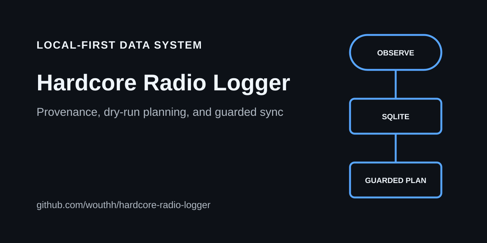

# Hardcore Radio Logger

Local-first radio discovery and library reconciliation with SQLite provenance, dry-run planning, and guarded synchronization.

## What it does

- Polls Hardcore Radio (Icecast status first, the official player page as fallback) or imports files from an external logger, and records each track as an observation.
- Keeps an append-only SQLite observation log with provenance: poll timestamps mean observed at, and ingestion time is stored separately.
- Reconciles the database with an explicitly configured local music folder, using a baseline backfill before any deletion detection.
- Optionally syncs a Spotify playlist and downloads matching audio from YouTube, with conservative matching, request budgets and durable pending intents.
- Plans every destructive change as a dry-run; changes happen only with an explicit `--apply`.
- Turns tracks removed from the local folder or the Spotify playlist into tombstones, so they are not downloaded or re-added later.



Radio observations are written to SQLite, which produces a guarded plan for the local folder, Spotify and YouTube.

## Why it is built this way

- **The database is the source of truth.** Logger files, the local music folder, YouTube, and Spotify are inputs or outputs.
- **Destructive work needs an explicit boundary.** Synchronization defaults to dry-run, local removals go to trash, and reconciliation refuses deletion detection when scans look unsafe. Setup commands such as `db init` and `spotify auth` can create local state without `--apply`.
- **Exclusions are tombstones, not deletions.** Excluded tracks keep their observations, events and asset history, and logger imports never reactivate them.

## Installation

Tested with Python 3.11, 3.12, 3.13, and 3.14.

```bash
python -m venv .venv
. .venv/bin/activate
pip install -r requirements.txt
```

Copy `.env.example` to `~/.config/hcr-sync/hcr-sync.env` and edit it. The CLI loads it automatically; you do not need to `source` it. See [Configuration Load Order](docs/operations.md#configuration-load-order) for every config source.

## Safe First-Run Flow

```bash
mkdir -p ~/.config/hcr-sync
cp .env.example ~/.config/hcr-sync/hcr-sync.env
nano ~/.config/hcr-sync/hcr-sync.env

python -m hcr_sync db init
python -m hcr_sync doctor

python -m hcr_sync import-logger --dry-run
python -m hcr_sync import-logger --apply

python -m hcr_sync backfill-local --dry-run
python -m hcr_sync backfill-local --apply

python -m hcr_sync spotify auth
python -m hcr_sync spotify backfill --dry-run
python -m hcr_sync spotify backfill --apply

python -m hcr_sync report
python -m hcr_sync run-once --dry-run
```

Only enable [systemd](docs/operations.md#running-with-systemd) after `doctor` passes, Spotify auth exists, and the dry-run output looks right.

## Safety Model

Destructive commands default to dry-run. Use `--apply` to make changes.

Use synchronization and download features only for media you are authorized to access and retain, and review the terms of each connected service. This project does not grant rights to third-party content.

Local file removals default to trash mode with `HCR_DELETE_MODE=trash`. The trash folder is configured by `HCR_TRASH_DIR`.

Reconciliation refuses destructive deletion detection when scans look unsafe, including missing folders, empty scans with known assets, suspicious scan-count drops, incomplete Spotify pagination, missing Spotify snapshot IDs, or too many removals without `--force-mass-delete`.

Two-pass deletion confirmation is enabled by default. The first healthy pass records a suspected deletion. The second healthy pass applies the global exclusion and cascades removal.

## Tombstones And Exclusions

Excluded tracks are not deleted from the database. They retain observations, events, and asset history.

Confirmed exclusion means:

- Do not download from YouTube.
- Do not add to Spotify.
- Remove from Spotify if present.
- Move local file to trash if present.
- Ignore future logger observations for activation.

Manual commands:

```bash
python -m hcr_sync exclude --track-id 123 --reason manual --apply
python -m hcr_sync exclude --artist "Artist" --title "Title" --reason manual --apply
python -m hcr_sync unexclude --track-id 123 --apply
```

Unexclude is explicit, logged, and does not erase history.

## Documentation

- [Operations](docs/operations.md): [database initialization and audit events](docs/operations.md#database-initialization), [importing logger files](docs/operations.md#importing-existing-logger-files), [backfilling a music folder](docs/operations.md#backfilling-an-existing-music-folder), [Spotify setup](docs/operations.md#spotify-setup), [the built-in poller](docs/operations.md#using-the-built-in-poller), [an external logger producer](docs/operations.md#using-an-external-logger-producer), [network routing](docs/operations.md#network-routing), [systemd](docs/operations.md#running-with-systemd), and [troubleshooting](docs/operations.md#troubleshooting).
- [YouTube scheduling and recovery](docs/youtube-scheduling-recovery.md): the persistent 1:1:1 search, retry and download queue, bounded subprocess limits, automatic matching, failure categories, backlog repair, pauses, and safe interrupted-download recovery.

## Local validation

Run `python -m pytest -q` with disposable fixtures and fake provider clients. The supported Python versions are 3.11 through 3.14; run the suite locally for each version. Before committing, also run the privacy/ignore checks in `AGENTS.md` and `git diff --check`. Hosted Actions are not required for delivery.
